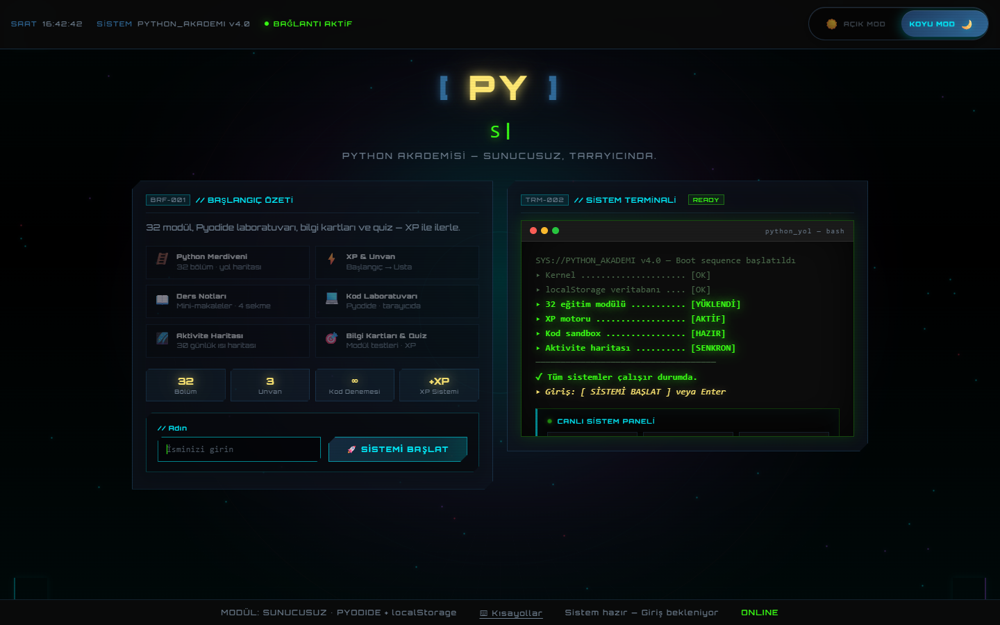
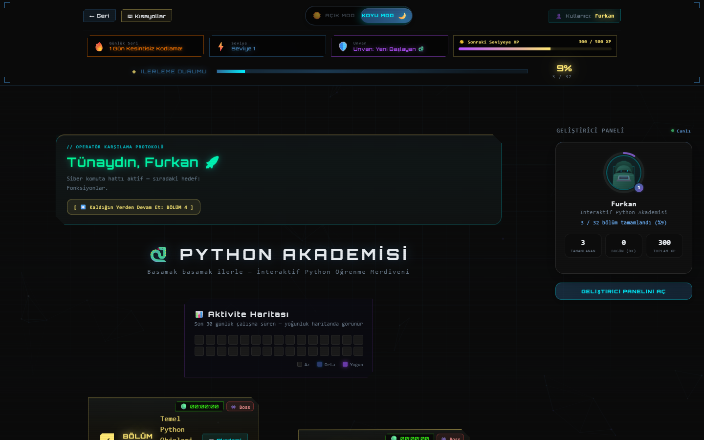
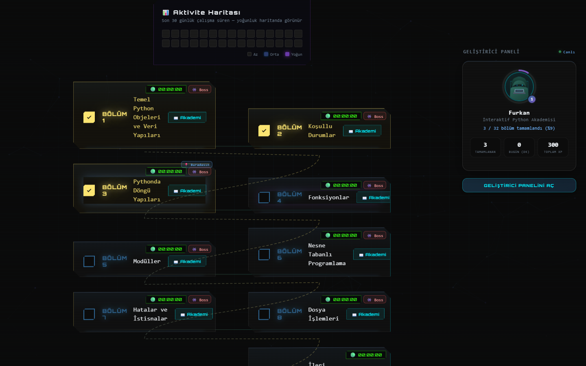
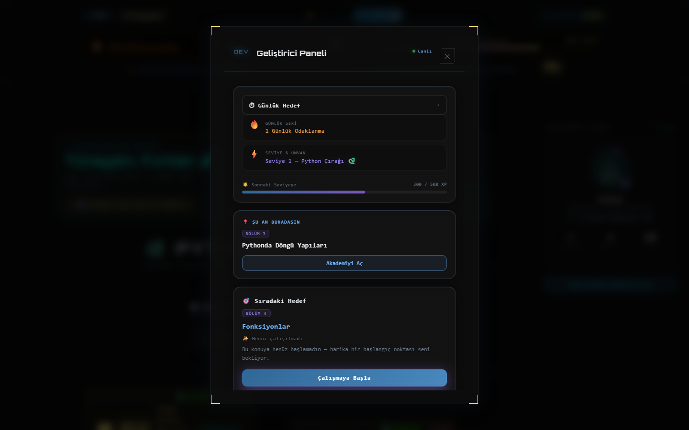
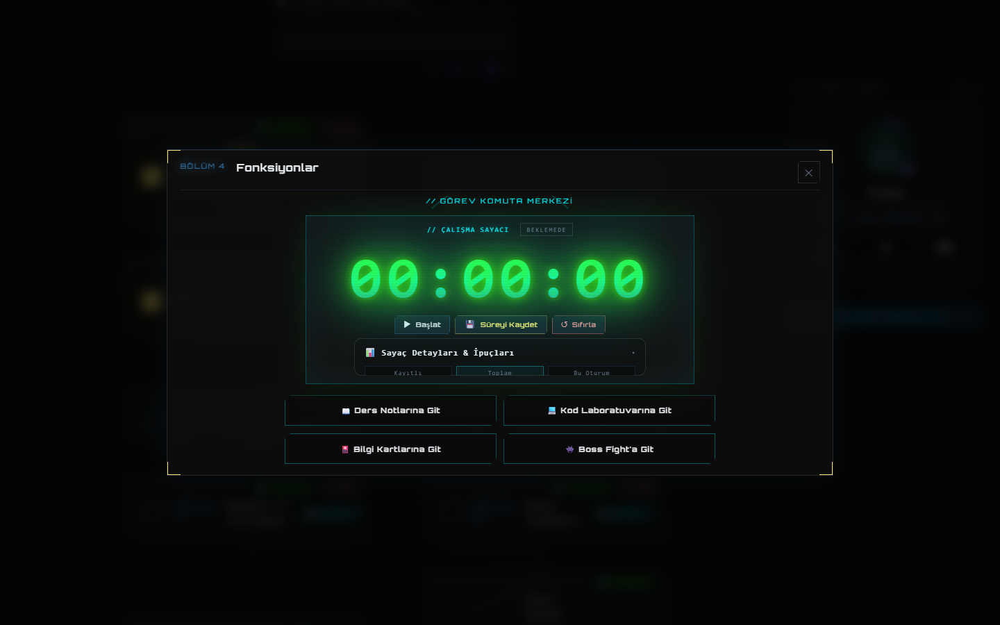
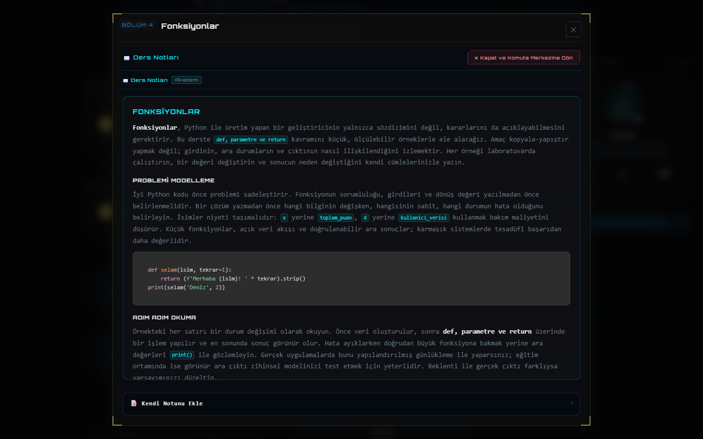
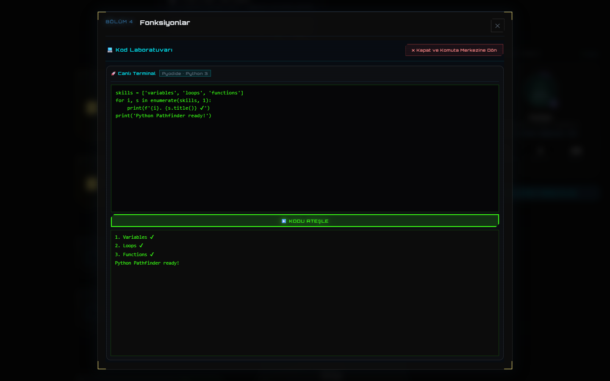
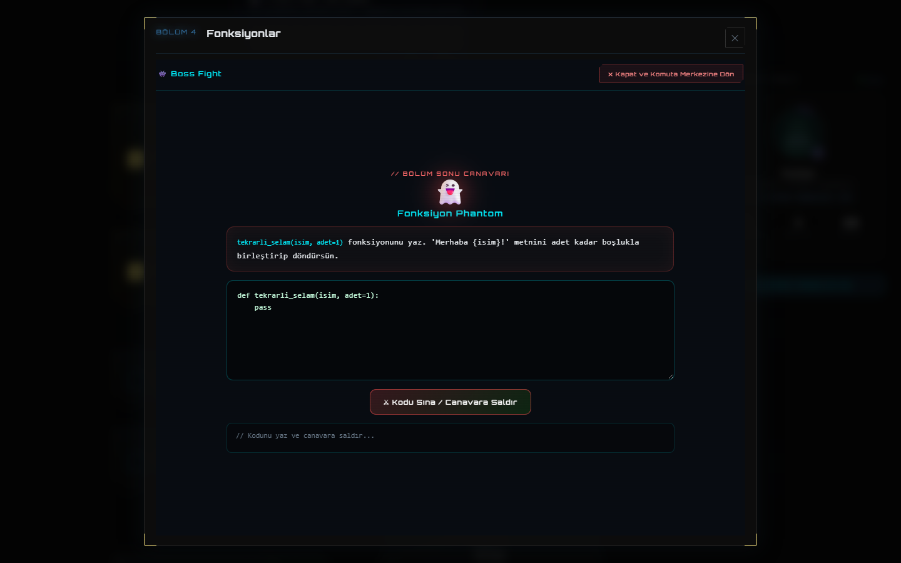
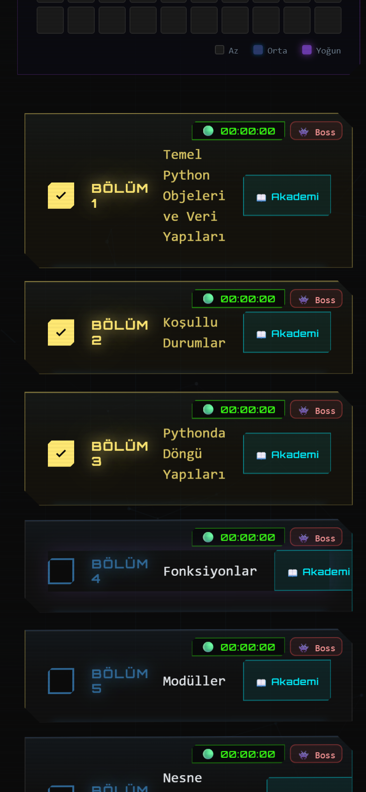

# Python Pathfinder

**Tamamen tarayıcıda çalışan, oyunlaştırılmış ve sunucusuz bir Python öğrenme platformu.**

Python Pathfinder, 32 bölümlük bir Python müfredatını interaktif bir merdivene dönüştürür: her bölüm; ders notları, canlı Python kod laboratuvarı, bilgi kartları ve bölüm sonu "boss fight" testi içeren bir basamaktır. İlerleme, XP, günlük seri ve çalışma süresi cihazda saklanır — hesap, sunucu veya kurulum gerekmez.

**Canlı demo:** [furkaneneskum.github.io/python-pathfinder](https://furkaneneskum.github.io/python-pathfinder/)



---

## Öne Çıkanlar

- **32 bölümlük öğrenme merdiveni** — temel veri tiplerinden ileri konulara uzanan, sağlı sollu iki şeritli yol haritası.
- **Tarayıcıda gerçek Python** — kodlar [Pyodide](https://pyodide.org/) (WebAssembly'ye derlenmiş CPython) ile istemci tarafında çalışır.
- **Oyunlaştırma motoru** — XP, seviyeler, beş geliştirici unvanı, günlük seri, günlük odak hedefi ve 30 günlük aktivite haritası.
- **Bölüm bazlı çalışma sayacı** — oturumu başlat / durdur / kaydet; kaydedilen dakikalar XP'ye dönüşür.
- **Geliştirici paneli** — kenarda kompakt bir profil özeti, tek tıkla ekranın ortasında açılan detaylı panel.
- **Yayında sıfır sunucu** — tüm veriler `localStorage`'da tutulur; site GitHub Pages üzerinde statik dosyalardan oluşur.
- **İsteğe bağlı FastAPI + SQLite backend** — yerel geliştirme ve API denemeleri için.
- **Duyarlı siberpunk arayüz** — glassmorphism, 3D eğim efektli kartlar, koyu/açık tema, klavye kısayolları ve mobil düzen.

---

## Ekran Turu

### 1. Giriş ve açılış sekansı

Giriş ekranı; müfredat modüllerini ve temel sayıları gösteren bir başlangıç özetini, platformu "başlatan" animasyonlu bir sistem terminaliyle birleştirir. Kullanıcı adını girip sistemi başlatır; isim cihazda saklanır ve arayüzün her yerinde kullanılır.


### 2. Ana panel

Giriş yapıldıktan sonra kullanıcı ana panele ulaşır:

- **HUD çubuğu** — günlük seri, seviye, unvan, sonraki seviyeye kalan XP ve genel tamamlanma yüzdesi.
- **Operatör karşılama paneli** — günün saatine göre selamlama ve sıradaki bölüme götüren *Kaldığın Yerden Devam Et* butonu.
- **Aktivite haritası** — son 30 günün çalışma süresi, yoğunluğa göre renklendirilmiş.
- **Geliştirici paneli özeti** — ilerleme halkalı avatar, tamamlanan bölümler, bugünkü çalışma dakikası ve toplam XP.



### 3. Öğrenme merdiveni

Ürünün kalbi. Bölümler, sağa ve sola inen iki şeritli bir merdiven şeklinde dizilir ve kesik çizgili bir yolla birbirine bağlanır. Her basamakta:

- tamamlama kutucuğu (ilk tamamlamada +100 XP),
- bölüm numarası ve başlığı,
- bölüme özel canlı çalışma sayacı,
- bölüm sonu testini gösteren **Boss** rozeti,
- bölümün çalışma odasını açan **Akademi** butonu bulunur.

Tamamlanan basamaklar altın renginde parlar; aktif bölüm *Buradasın* etiketiyle işaretlenir.



### 4. Geliştirici paneli

Kenar çubuğunda yalnızca temel bilgiler kalır. *Geliştirici panelini aç* butonu, ekranın ortasında tam ekrandan biraz küçük bir pencere açar ve ilerlemeyi takip etmek için gereken her şeyi gösterir:

- ilerleme halkalı günlük odak hedefi (15 / 30 / 45 / 60 dakika),
- seri, seviye ve unvan,
- sonraki seviyeye XP çubuğu,
- tek tıkla *Çalışmaya Başla* butonlu **Şu An Buradasın** ve **Sıradaki Hedef** kartları,
- modül ilerleme listesi, çevrilebilir *Günün Python İpucu* kartı ve son 7 günün aktivite özeti.



### 5. Görev komuta merkezi

Bir bölüm açıldığında komuta merkezi görünür: kayıtlı / oturum / toplam süre dökümlü büyük bir çalışma sayacı (başlat, kaydet, sıfırla) ve öğrenme içeriğine giden dört yol — ders notları, kod laboratuvarı, bilgi kartları ve boss fight.



### 6. Ders notları

Her bölüm, mini makale formatında uzun bir ders içeriğiyle gelir: kavram tanıtımı, problemi modelleme, örnekleri adım adım okuma, sık yapılan hatalar ve gerçek dünya kullanımı; sözdizimi renklendirilmiş kod örnekleriyle. Kullanıcı ayrıca canlı önizlemeli kişisel Markdown notları tutabilir.



### 7. Canlı kod laboratuvarı

Pyodide ile çalışan, tarayıcı tabanlı bir Python terminali. Kod WebAssembly içinde yerel olarak çalıştırılır — hiçbir şey sunucuya gönderilmez — ve çıktılar (hatalar dahil) terminal panelinde gösterilir.



### 8. Boss fight

Her bölüm, temaya uygun bir "canavara" karşı bir kodlama göreviyle biter. Kullanıcı bir fonksiyon yazar, platform bu fonksiyonu Pyodide'da gizli testlerle sınar. Bölüm testi ilk kez geçildiğinde bölüm tamamlanmış sayılır ve XP kazanılır.



### 9. Mobil görünüm

Küçük ekranlarda merdiven tek ve okunaklı bir sütuna dönüşür, HUD dikey olarak dizilir ve ekranın altında sabit bir *Sıradaki hedef* çubuğu kalır.

<p align="center">
  
</p>

---

## Oyunlaştırma Kuralları

| Eylem | Ödül |
| --- | --- |
| Bölümü tamamlamak (ilk kez) | +100 XP |
| Bölüm testini geçmek (ilk kez) | +100 XP, bölüm tamamlandı olarak işaretlenir |
| Bilgi kartını "Anladım" ile onaylamak | +10 XP |
| Çalışma süresini kaydetmek | Dakika başına +10 XP |
| Seviye atlamak | Her 500 XP'de bir |

Geliştirici unvanları yeni avatar efektlerinin kilidini açar:

| XP | Unvan |
| --- | --- |
| 0 | Python Çırağı |
| 500 | Kod Geliştiricisi |
| 1.500 | Python Uzmanı |
| 3.000 | Veri Ustası |
| 5.000 | Full-Stack Yazılımcı |

---

## Teknolojiler

| Katman | Teknoloji |
| --- | --- |
| Arayüz | HTML5, CSS3 (glassmorphism, 3D dönüşümler, CSS grid), vanilla JavaScript (ES2020+) |
| Tarayıcıda Python | Pyodide (WebAssembly CPython) |
| Veri saklama | `localStorage` (sürümlü durum nesnesi) |
| Kod renklendirme | Prism.js |
| Yayın | GitHub Pages (statik, `docs/` klasöründen) |
| İsteğe bağlı backend | Python, FastAPI, SQLite, Uvicorn |

---

## Mimari

```
┌──────────────────────────── Tarayıcı ────────────────────────────┐
│  index.html + style.css                                           │
│  script.js ── arayüz, merdiven, sayaç, XP motoru, geliştirici paneli │
│  academy-content.js ── ders notları, bilgi kartları, boss fight'lar │
│  storage.js ── localStorage durumu (konular, istatistik, aktivite) │
│  Pyodide (WebAssembly) ── kullanıcı kodunu yerelde çalıştırır      │
└───────────────────────────────────────────────────────────────────┘
          ▲ statik dosyalar                  ▲ isteğe bağlı REST API
   GitHub Pages (docs/)              FastAPI + SQLite (backend/)
```

- Yayındaki sürüm tamamen statiktir: GitHub Pages `docs/` klasörünü sunar ve tüm kullanıcı verisi cihazda kalır.
- Asıl kaynak `frontend/` klasörüdür; `scripts/sync-docs.ps1` bunu yayın için `docs/` klasörüne kopyalar.
- FastAPI backend'i aynı veri modelini (konular, XP, seri, aktivite) yerel geliştirme için SQLite'ta tutar.

---

## Proje Yapısı

```
frontend/          Kaynak arayüz (HTML, CSS, JS, ders içerikleri)
docs/              GitHub Pages yayın klasörü (frontend/ kopyası)
backend/           Yerel geliştirme için FastAPI + SQLite API
scripts/           Yardımcı betikler (sync-docs.ps1)
assets/screenshots Bu README'deki ekran görüntüleri
```

---

## Yerelde Çalıştırma

**Statik sürüm (yayındakiyle aynı):**

```powershell
cd docs
python -m http.server 8000
```

Tarayıcıda [http://127.0.0.1:8000](http://127.0.0.1:8000) adresini açın.

**FastAPI backend ile:**

```powershell
pip install -r requirements.txt
cd backend
python -m uvicorn main:app --reload
```

Tarayıcıda [http://127.0.0.1:8000](http://127.0.0.1:8000) adresini açın.

---

## Yayına Alma

1. Dosyaları `frontend/` klasöründe düzenleyin.
2. `docs/` klasörüne kopyalayın:

   ```powershell
   .\scripts\sync-docs.ps1
   ```

3. `main` dalına commit ve push yapın. GitHub Pages, `main` → `/docs` kaynağından otomatik yayınlar.

---

## Lisans

[Furkan Enes Kum](https://github.com/furkaneneskum) tarafından geliştirilen kişisel eğitim projesi.
